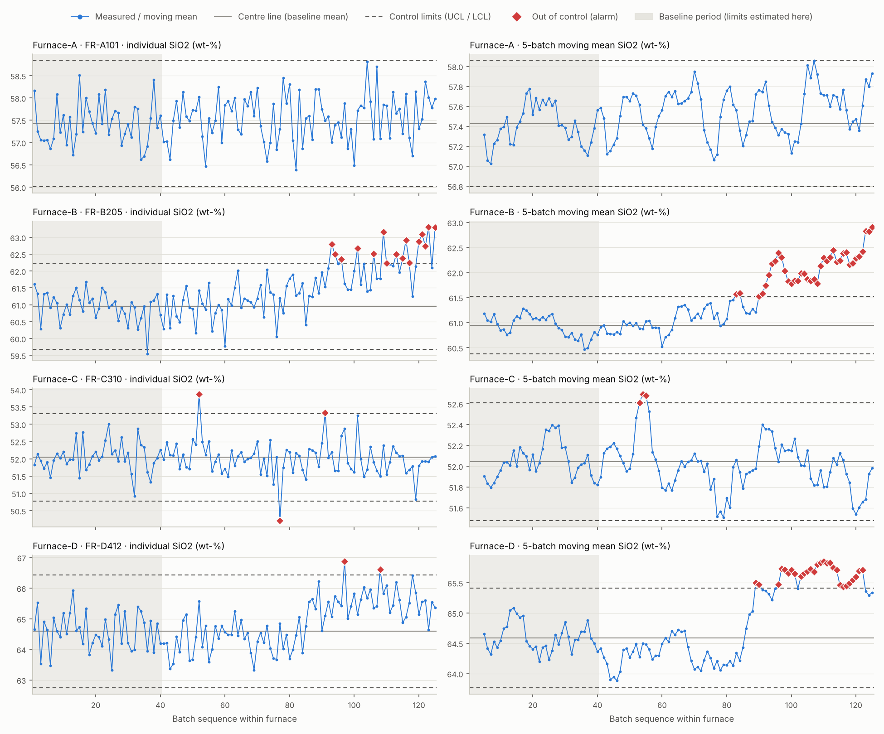

# Statistical Process Control for Frit Melting Furnaces (PostgreSQL)

Control charts and out-of-control alarms for SiO2 content in frit batches, built entirely with SQL window functions and nested CTEs on PostgreSQL.

> **All data in this repository is synthetic.** It was generated by `src/generate_data.py` (fixed seed) to mimic the structure and value ranges of ceramic frit production. No real plant, supplier or customer data is used.

## Objective

Frit furnaces drift slowly, jump after a raw-material lot change, or produce the occasional bad sample. Adjusting a process on every small fluctuation makes things worse; waiting too long ruins whole campaigns. This project implements a methodical rule set that answers one question per batch: *is the process still in statistical control, or does it need an adjustment?*

## Techniques Used

- Window functions with explicit frames (`ROWS BETWEEN 4 PRECEDING AND CURRENT ROW`), named windows (`WINDOW w AS ...`), `ROW_NUMBER()`, `AVG() OVER`, `COUNT() OVER`
- Nested CTEs (`windowed -> joined -> flagged`) and reusable views (`spc_baseline`, `spc_series`, `spc_monitoring`)
- Aggregate `FILTER (WHERE ...)` clauses for per-rule alarm counts and first-alarm detection
- Two-phase SPC: control limits frozen from a baseline period, then applied to all later batches
- Client-side CSV export with `\copy`, plus a small Python/matplotlib script that only draws the charts (all statistics stay in SQL)
- Reproducible environment with Docker Compose (PostgreSQL 16)

## Key Findings

Four furnaces, 125 batches each; the first 40 batches per furnace form the baseline, the remaining 85 are monitored. Process scenarios were injected into the synthetic data on purpose, so the table below shows how well the rules recover them.

| Furnace | Injected scenario | Individual-value rule (+/-3 sigma) | 5-batch moving-mean rule (+/-3 sigma/sqrt(5)) |
|---|---|---|---|
| A | none (control case) | 0 alarms | 0 alarms |
| B | slow drift of +0.03 wt-% per batch from batch 70 | first alarm at batch 93 | first alarm at batch 83, ten batches earlier |
| C | three isolated spikes (batches 52, 77, 101) | alarms at 52 and 77; the spike at 101 (53.25) stayed just below the UCL (53.31) | alarms at 53-55 caused by the batch-52 spike |
| D | step change of +1.1 wt-% from batch 85 | first alarm at batch 97, only 2 alarms in 85 batches | first alarm at batch 89, four batches after the step |

- The moving-mean rule detects small persistent shifts (B, D) much earlier than the individual rule, which is nearly blind to a shift of about 1.8 sigma (D).
- The individual rule is the one that catches isolated spikes (C); a spike also contaminates the moving mean for the next four batches, so one bad sample produces a short burst of MEAN5 alarms.
- No rule is perfect. One injected spike (C, batch 101) was missed, and one alarm on Furnace C (batch 91) comes from natural scatter rather than an injected event. With 3-sigma limits roughly 1 in 370 in-control points is expected to alarm; here limits are also estimated from only 40 batches.

Full chart: [`output/control_charts.png`](output/control_charts.png) (left: individual values, right: 5-batch moving mean; red diamonds mark alarms; grey area is the baseline period).



## How the Limits Are Calculated

For each furnace, over the baseline batches:

```
centre line  = mean(SiO2)
sigma        = sample standard deviation of SiO2

individual values :  UCL / LCL = centre +/- 3 * sigma
5-batch mean      :  UCL / LCL = centre +/- 3 * sigma / sqrt(5)
```

A batch raises an alarm when

- `point_alert`: its own SiO2 value lies outside the individual limits, or
- `mean_alert`: the mean of the last 5 batches (current batch included, window must be full) lies outside the narrower mean limits.

Why the limits are frozen: if they were recomputed from the same rolling window that is being tested, a drifting process would drag its own limits along with it and almost never alarm. Why `sigma / sqrt(5)` for the mean: averaging 5 independent values shrinks the scatter by `sqrt(5)`, so the limits for the mean are narrower than for single values.

## Data

`data/frit_batches.csv`, 500 rows (4 furnaces x 125 batches, one batch roughly every 8 hours, March to April 2026).

| Column | Description |
|---|---|
| `batch_id` | Unique batch identifier, e.g. `B-0093` |
| `furnace_id` | Melting furnace (`Furnace-A` ... `Furnace-D`); each runs one frit campaign |
| `frit_code` | Frit produced during the campaign (fictional codes) |
| `produced_at` | Sampling timestamp |
| `sio2_pct` | SiO2 content, wt-% (monitored metric) |
| `al2o3_pct` | Al2O3 content, wt-% |
| `zro2_pct` | ZrO2 content, wt-% |
| `loi_pct` | Loss on ignition, wt-% |

Only `sio2_pct` is monitored; monitoring another column (for example `zro2_pct`) means replacing the column name in `sql/02` and `sql/03`.

## How to Run

Requirements: Docker with Compose, Python 3.10+.

```bash
pip install -r requirements.txt
bash run_all.sh
```

`run_all.sh` (bash; on Windows use Git Bash or WSL) starts PostgreSQL 16, executes the SQL scripts in order and draws the charts. The steps can also be run by hand in any shell:

```bash
docker compose up -d --wait
docker compose exec -w /project db psql -U postgres -d glaze -f sql/01_schema_and_load.sql
docker compose exec -w /project db psql -U postgres -d glaze -f sql/02_control_limits.sql
docker compose exec -w /project db psql -U postgres -d glaze -f sql/03_spc_monitoring.sql
docker compose exec -w /project db psql -U postgres -d glaze -f sql/04_alert_summary.sql
docker compose exec -w /project db psql -U postgres -d glaze -f sql/05_export_results.sql
python src/plot_control_charts.py
```

To regenerate the dataset: `python src/generate_data.py`.

## Project Structure

```
glaze-batch-spc-sql/
├── README.md
├── docker-compose.yml
├── run_all.sh
├── requirements.txt
├── data/
│   └── frit_batches.csv              synthetic batch analyses
├── sql/
│   ├── 01_schema_and_load.sql        table + CSV load
│   ├── 02_control_limits.sql         baseline limits (view spc_baseline)
│   ├── 03_spc_monitoring.sql         window functions + alarm rules (views spc_series, spc_monitoring)
│   ├── 04_alert_summary.sql          alarms per furnace
│   └── 05_export_results.sql         CSV export for charting
├── src/
│   ├── generate_data.py              synthetic data generator (documents injected scenarios)
│   └── plot_control_charts.py        control chart rendering
└── output/
    ├── control_limits.csv
    ├── alerts.csv
    ├── spc_series.csv
    └── control_charts.png
```

## Limitations

- Limits come from a 40-batch baseline that is assumed to be in control; if the baseline itself contains a disturbance, sigma is inflated and sensitivity drops.
- The rules assume roughly normal and independent measurements. Real furnace data is often autocorrelated, which would call for a different chart (for example EWMA or CUSUM).
- Only two of the classical rule families are implemented (points beyond limits, shift in the moving mean). Run rules such as "8 consecutive points on one side of the centre line" are not.
